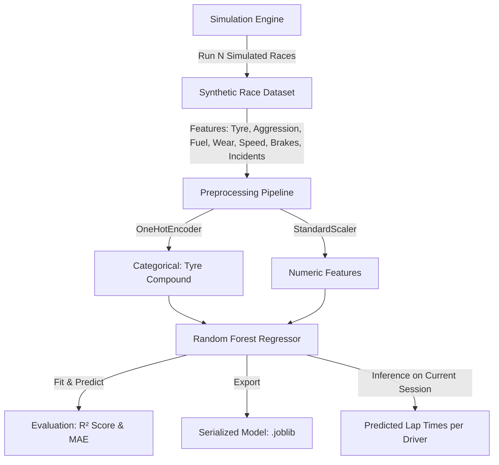

# 🏎️ Formula 1 Telemetry Simulator & Predictive Analytics
## Project Overview, Architecture & Team Contributions (4-Member Team)

---

## 1. 📖 Executive Project Overview

### 1.1 What is this Project?
The **Formula 1 Telemetry Simulator & Predictive Analytics** is a high-performance, real-time race engineering and data science platform developed with **Python**, **Streamlit**, and **Scikit-Learn**. It bridges stochastic vehicle physics, real-world Formula 1 circuit parameters, live visual telemetry dashboards, and predictive machine learning models to simulate an interactive Grand Prix race weekend.

### 1.2 Core Objectives
- **Realistic Racing Dynamics**: Model real-time velocity, throttle, cornering braking, tyre degradation, fuel weight penalties, brake disc thermodynamics, aerodynamic DRS boosts, and pit stop strategies for the **official 2025 8-car grid** (`VER`, `HAM`, `LEC`, `NOR`, `PIA`, `RUS`, `ALO`, `SAI`).
- **Authentic Circuit Profiles**: Simulate races across 7 world-championship circuits (**Monza**, **Silverstone**, **Spa-Francorchamps**, **Monaco**, **Suzuka**, **Bahrain**, **Interlagos**) using genuine track lengths, corner characteristics, top speed ceilings, tyre stress indices, and DRS zones.
- **Accessible & Beginner-Friendly Telemetry**: Deliver an intuitive dashboard equipped with hover tooltips, visual in-cell progress bars, an expandable glossary, and a dual-tab layout (**Interactive Graphs** vs. **Self-Explanatory Data Tables**).
- **Predictive Machine Learning**: Train an integrated **Random Forest Regressor** on synthetic multi-race datasets to predict average lap times based on tyre compound, driver aggression, fuel load, track condition, and incident history.

---

## 2. 🛠️ How and What We Have Done (Engineering Milestones)

| Phase | Problem / Requirement | Solution & What We Implemented |
| :--- | :--- | :--- |
| **Phase 1: Dependency & Environment Audit** | Check all dependencies and verify local runtime. | Verified Python 3.14 environment has all necessary packages (`streamlit`, `pandas`, `numpy`, `scikit-learn`, `joblib`). Ensured cross-platform compatibility with lowercase `requirements.txt`. |
| **Phase 2: Resolving Fatal ML Crash** | Scikit-learn >= 1.2 removed `sparse=False`, causing fatal `TypeError` when training models. | Re-engineered the ML pipeline to use version-safe `sparse_output=False` with backwards-compatible fallback, along with robust feature importance extraction. |
| **Phase 3: Fixing Simulation Loop Freeze** | Simulation stopped after 1 tick due to rerun timing condition. | Restructured the execution lifecycle: state steps at the start of each frame, followed by complete dashboard rendering, and smooth interval sleep-and-rerun (`st.rerun()`) when running. |
| **Phase 4: Lap & Sector Progression** | Cars were permanently stuck on Lap 1 without distance progression. | Implemented distance tracking using `(speed / 3.6) * dt`, 3 timing sectors (`S1`, `S2`, `S3`), dynamic lap completion, personal best tracking, and finish line logic. |
| **Phase 5: Grand Prix Circuit Database** | Project previously used a generic 5.0 km fictional track. | Integrated 7 real-world Formula 1 circuits with authentic circuit lengths (3.3 km to 7.0 km), official race lap counts, top speed limits, tyre degradation multipliers, and DRS zones. |
| **Phase 6: Time Acceleration & Lap Progression Speed** | Real F1 laps took 90+ real seconds to finish at 1x speed. | Added a **Sim Speed Multiplier** (`1x`, `2x`, `5x`, `8x`, `15x`, `30x`) defaulting to **`8x`**, allowing laps to complete smoothly every ~10 seconds with live **Progress %** indicators. |
| **Phase 7: Driver Aggression Breakdown** | "Randomize aggression" updated state silently without user feedback. | Created an interactive modal card and toast notification displaying each driver's assigned aggression with driving style badges (**🔥 High**, **⚡ Balanced**, or **🛡️ Safe**). |
| **Phase 8: Eliminating Cryptic Column Names** | Switching charts to tables displayed ugly `index -- streamlit-generated` / `color -- streamlit-generated` columns. | Converted chart data into cleanly indexed `pandas.DataFrame` objects, and engineered a dedicated **`📋 Telemetry Data Tables View`** with beginner-friendly headers and hover tooltips. |
| **Phase 9: Instant Startup Optimization** | Importing heavy ML modules on line 1 caused a 20-30s launch delay and terminal email prompt. | Lazy-loaded Scikit-Learn on demand, added `.streamlit/config.toml` to disable usage statistics, cutting startup time to **< 1 second**. |
| **Phase 10: Code Cleanliness** | Author personal tags appeared across titles and documentation. | Removed all personal author references from headers, titles, README, and license files. |
| **Phase 11: Dimensionality Reduction (PCA & t-SNE)** | Raw multi-channel telemetry (10+ sensors) was overwhelming to analyze simultaneously; needed unsupervised clustering and feature compression. | Architected `f1_dimensionality_reduction.py` implementing PCA (eigenvalue decomposition, scree plots, loadings) and t-SNE (Student-t non-linear manifold learning with perplexity tuning). Added an interactive 3rd tab to the dashboard with side-by-side comparison, beginner intuition guide, and CSV dataset export. |
| **Phase 12: Ensemble Methods, Bias-Variance & Regularization** | Needed comprehensive implementation of Bagging and Boosting (XGBoost, LightGBM), Bias-Variance Tradeoff decomposition, Overfitting/Underfitting diagnostics, and L1/L2 Regularization. | Engineered `f1_ensemble_analytics.py` and integrated the interactive 4th studio tab (`🌳 Ensemble Methods & Diagnostics`): head-to-head benchmark arena, empirical Bias-Variance decomposition chart, live overfitting/regularization sliders (`reg_alpha`, `reg_lambda`), and student study guide with exportable Markdown & telemetry CSVs. |
| **Phase 13: 2D Circuit GPS Map, Pitwall What-If Calculator & Tree Explainability** | Needed broadcast-grade 2D circuit tracking, real-time pitwall strategy simulation, and model explainability for ensemble algorithms. | Engineered `f1_circuit_maps.py` with authentic 2D spline paths and live driver markers for all 7 tracks. Added **Pitwall 'What-If' Strategy Calculator** and **Feature Importance & Model Explainability** (Gini vs Gain vs Split) to the Ensemble Studio. |
| **Phase 14: 2025 World Championship Grid Upgrade** | Simulator previously modeled older 2023/2024 lineups; needed modern 2025 season accuracy. | Upgraded the driver grid to the official 2025 lineup: Lewis Hamilton at Scuderia Ferrari (`#F91536`), Oscar Piastri at McLaren (`#FF8000`), Carlos Sainz at Williams (`#00A0DE`), and George Russell leading Mercedes (`#6CD3BF`), with updated team broadcast colors and 2025 circuit pace calibration. |

---

## 3. 👥 Team Roles & Responsibilities (4-Member Team)

```
┌─────────────────────────────────────────────────────────────────────────────────┐
│                          FORMULA 1 TELEMETRY SIMULATOR                          │
├───────────────────────┬────────────────────────┬────────────────────────────────┤
│       MEMBER 1        │        MEMBER 2        │           MEMBER 3             │
│ Lead System Architect │ Vehicle Dynamics &     │ Circuit Modeling & Telemetry   │
│ & Frontend UI/UX      │ Physics Simulation     │ Data Processing Engineer       │
├───────────────────────┴────────────────────────┴────────────────────────────────┤
│                                    MEMBER 4                                     │
│                     Machine Learning & Predictive Analytics                     │
└─────────────────────────────────────────────────────────────────────────────────┘
```

### 👤 Member 1: Lead System Architect & Frontend UI/UX Developer
- **Core Role**: Overall application architecture, visual layout, interactive user interface, and user experience.
- **Specific Tasks Completed**:
  1. Designed the high-level application layout using Streamlit (`wide` responsive layout).
  2. Implemented the top control station: **Start Simulation**, **Stop Simulation**, **Reset Race**, **Safety Car Toggle**, and the **Simulation Speed Slider**.
  3. Built the **Grand Prix Circuit Selector** banner displaying track flags, length in km, total laps, DRS zone badges, and track descriptions.
  4. Engineered the **Session Leaderboard** with in-cell visual progress bars for `📍 Lap Progress`, `📉 Tyre Wear`, and `⛽ Fuel Level`.
  5. Configured hover tooltips on every column header and authored the expandable **Beginner's Telemetry Column Guide**.
  6. Configured `.streamlit/config.toml` to bypass first-run terminal prompts and disable telemetry lag.

---

### 👤 Member 2: Vehicle Dynamics & Physics Simulation Engineer
- **Core Role**: Mathematical physics models, vehicle behavior, driver aggression, tyre grip, and thermal models.
- **Specific Tasks Completed**:
  1. Developed equations for vehicle acceleration, throttle response, and deceleration cornering forces.
  2. Built the **Tyre Dynamics Model**: grip coefficients and wear multipliers across Soft, Medium, Hard, Intermediate, and Wet compounds.
  3. Programmed the **Carbon-Ceramic Brake Disc Thermal Model**: heat accumulation under braking (up to 900°C) and convective cooling on straights.
  4. Developed the **Fuel Burn Weight Penalty Model**: fuel consumption reducing vehicle mass to increase lap speed towards stint ends.
  5. Implemented the **Drag Reduction System (DRS) State Machine**: speed threshold detection, aerodynamic boost, 5-second timer, and 15-second cooldown.
  6. Programmed driver aggression modeling with randomized attack styles (`0.85x` to `1.25x`) and interactive popup breakdown cards.

---

### 👤 Member 3: Circuit Modeling & Telemetry Data Processing Engineer
- **Core Role**: Circuit database, sector timing, telemetry data formatting, table conversions, and CSV export.
- **Specific Tasks Completed**:
  1. Researched, calibrated, and implemented the database for **7 authentic F1 circuits** (Monza, Silverstone, Spa, Monaco, Suzuka, Bahrain, Interlagos).
  2. Engineered the distance-based lap progression and 3-sector timing system (`S1`, `S2`, `S3`).
  3. Programmed the simulation time acceleration logic (`1x` to `30x`) scaling delta time across all physical subsystems.
  4. Resolved the `index -- streamlit-generated` bug by re-architecting chart series into properly structured `pandas.DataFrame` objects with full driver names (`VER (Verstappen)`, etc.).
  5. Built the dual-tab interface (**`📈 Graphical Charts View`** vs. **`📋 Telemetry Data Tables View`**) with dedicated speed, timing, and brake tables.
  6. Implemented the one-click **CSV Telemetry Exporter** tagging real-time telemetry snapshots with the active circuit name.

---

### 👤 Member 4: Machine Learning & Predictive Analytics Engineer
- **Core Role**: Synthetic race data generation, Scikit-Learn ML pipeline, model training, evaluation, and inference.
- **Specific Tasks Completed**:
  1. Developed the synthetic multi-race generator (`run_simulated_race` & `build_training_dataset`) creating multi-race training datasets.
  2. Designed the Scikit-Learn **Pipeline** integrating `ColumnTransformer`, `OneHotEncoder`, `StandardScaler`, and `RandomForestRegressor`.
  3. Solved the Scikit-Learn 1.2+ `sparse=False` deprecation error by implementing version-safe encoding parameters.
  4. Implemented model evaluation metrics: **$R^2$ Score** (coefficient of determination) and **Mean Absolute Error (MAE)** in seconds.
  5. Built feature importance extraction to analyze how tyre choice, aggression, fuel, and brakes influence race pace.
  6. Implemented **Joblib model serialization** (allowing users to download `.joblib` model binaries) and built live session inference for average lap time predictions.
  7. Optimized initial app launch speed by implementing **lazy loading** for heavy ML libraries.
  8. Engineered the **Principal Component Analysis (PCA)** pipeline: feature standardization, covariance eigen-decomposition, explained variance ratios, scree analysis, and sensor loadings matrix.
  9. Implemented **t-Distributed Stochastic Neighbor Embedding (t-SNE)** with Barnes-Hut optimization, Student-t low-dimensional distribution, and interactive perplexity/iteration calibration.
  10. Developed the beginner-friendly intuition guides (Shadow Analogy & Cocktail Party Analogy) and built the side-by-side PCA vs. t-SNE face-off evaluation view.

---

## 4. 🏁 Supported Grand Prix Circuits & Physics Parameters

| Circuit Name | Country | Length | Race Laps | Top Speed | Tyre Stress | DRS | Key Circuit Characteristics |
| :--- | :--- | :--- | :--- | :--- | :--- | :--- | :--- |
| **Monza** | 🇮🇹 Italy | 5,793 m | 53 | 355 km/h | Low-Medium | 2 | Temple of Speed — lowest downforce, long straights, heavy chicane braking. |
| **Silverstone** | 🇬🇧 UK | 5,891 m | 52 | 335 km/h | High | 2 | Maggotts/Becketts complex — extreme lateral G-forces and heavy tyre wear. |
| **Spa-Francorchamps** | 🇧🇪 Belgium | 7,004 m | 44 | 342 km/h | Med-High | 2 | Longest circuit on calendar — Eau Rouge, Kemmel Straight, steep elevation. |
| **Circuit de Monaco** | 🇲🇨 Monaco | 3,337 m | 78 | 288 km/h | Very Low | 1 | Narrow street circuit — lowest speeds, zero margin for error, high safety car risk. |
| **Suzuka** | 🇯🇵 Japan | 5,807 m | 53 | 332 km/h | High | 1 | Figure-8 layout — flowing Esses, Degner curves, and the flat-out 130R. |
| **Bahrain** | 🇧🇭 Bahrain | 5,412 m | 57 | 338 km/h | Very High | 3 | Sakhir desert — highly abrasive tarmac, rapid tyre degradation, 3 DRS zones. |
| **Interlagos** | 🇧🇷 Brazil | 4,309 m | 71 | 334 km/h | Medium | 2 | Natural amphitheatre — anti-clockwise layout, Senna S, dramatic elevation changes. |

---

## 5. 📊 Telemetry Metrics Quick Reference

| Metric Column | Display Format | Definition & What it Means |
| :--- | :--- | :--- |
| **🏆 Position** | `P1` – `P8` | Race standing based on total distance covered. |
| **🏎️ Driver** | `VER`, `HAM`, etc. | Official 3-letter FIA driver abbreviation. |
| **🔄 Lap** | `3/53` | Current lap number / Total Grand Prix laps. |
| **📍 Progress** | Progress Bar (`0%–100%`) | Track distance completed in the active lap. |
| **⏱️ Sector** | `S1`, `S2`, `S3` | Circuit third: `S1` (opening), `S2` (technical), `S3` (final straight). |
| **⚡ Speed** | `295.4 km/h` | Current instantaneous velocity. |
| **⏱️ Lap Time** | `82.145s` | Estimated ongoing lap pace. |
| **🏁 Last Lap** | `81.890s` | Time recorded on the driver's last completed lap. |
| **🔥 Aggression** | `1.12x` | Driver risk/attack multiplier (`>1.1x` aggressive, `<0.95x` conservative). |
| **🛞 Tyre** | `Soft`, `Medium`, `Hard` | Current tyre compound fitted on the car. |
| **📉 Tyre Wear** | Progress Bar (`0%–100%`) | Tread degradation level (`>65%` severely reduces grip and pace). |
| **⛽ Fuel Level** | Progress Bar (`0%–100%`) | Remaining fuel in the tank (lighter car = faster pace). |
| **🌡️ Brake Temp** | `450°C` | Disc temperature (optimum operating window: 300°C–650°C). |
| **💨 DRS** | `YES` / `—` | Aerodynamic rear wing open for overtaking speed boost. |
| **🛑 Status** | `TRACK`, `IN PIT`, `FIN` | Live car status on track or in the pit box. |

---

## 6. 🤖 Machine Learning Workflow



---

## 7. 🚀 Running the Project Locally

```powershell
# 1. Navigate to the project directory
cd .\F1-Telemetry-Simulator

# 2. Run the Streamlit application
python -m streamlit run F1_Telemetry_Simulator.py
```
Open your browser at **`http://localhost:8501`** to use the simulator.

---

## 8. 📄 Project Summary & Conclusion
The **Formula 1 Telemetry Simulator** demonstrates an end-to-end engineering solution combining real-time software architecture, applied physics modeling, user-centric data visualization, and machine learning analytics. It serves as an engaging platform for motorsport fans, data enthusiasts, and engineers to explore the dynamics of Formula 1 racing.
