# 🏎️ Dimensionality Reduction in F1 Telemetry: PCA & t-SNE
## Comprehensive Gap Analysis & Technical Implementation Specification

---

## 1. 📌 Executive Summary & Task Scope

### 1.1 Stated Objectives
- **Core Topic 1: PCA (Principal Component Analysis)**: Mathematical intuition, variance maximization, orthogonal projections, eigenvalues/eigenvectors, component loadings, scree plots, and dimensionality reduction applications in high-dimensional telemetry.
- **Core Topic 2: t-SNE (t-Distributed Stochastic Neighbor Embedding)**: Probabilistic neighborhood preservation, high-dimensional Gaussian affinities vs. low-dimensional Student-t distribution, resolving the crowding problem, perplexity intuition, and non-linear manifold visualization.
- **Applied Goal**: Bridge dimensionality reduction theory directly with Formula 1 telemetry analytics (multi-channel vehicle dynamics, driver behavior, tyre degradation regimes, and thermal profiles).
- **Deliverable**: Create `implementation.md` detailing **what currently exists** in the repository and **what needs to be added** to implement, visualize, and explain PCA and t-SNE end-to-end.

---

## 2. 🔍 State of the Repository: What Currently Exists

A detailed audit of the current codebase (`F1_Telemetry_Simulator.py`, `Requirements.txt`, `PROJECT_OVERVIEW_AND_CONTRIBUTIONS.md`) reveals the following architectural baseline:

| Architectural Layer | Existing Components & Capabilities | Status |
| :--- | :--- | :--- |
| **High-Dimensional Telemetry Streams** | The physics engine tracks 12+ dynamic variables per car per tick: `speed`, `throttle`, `brake`, `lap_time`, `last_lap_time`, `tyre_wear`, `fuel`, `brake_temp`, `distance`, `drs_active`, `aggression`, and `sector`. | ✅ **Exists** |
| **Synthetic Multi-Race Dataset** | `run_simulated_race()` and `build_training_dataset()` generate tabular race datasets with categorical features (`tyre`) and continuous features (`start_aggression`, `start_fuel`, `start_tyre_wear`, `start_brake_temp`, `avg_speed`, `avg_brake`, `pit_count`, `incidents`, `target_avg_lap`). | ✅ **Exists** |
| **Supervised ML Pipeline** | A Scikit-Learn `Pipeline` combining `OneHotEncoder`, `StandardScaler`, and `RandomForestRegressor` trains models to predict average lap times. | ✅ **Exists** |
| **Runtime Dependencies** | `Requirements.txt` contains `scikit-learn`, `pandas`, `numpy`, `streamlit`, and `joblib`. `sklearn.decomposition.PCA` and `sklearn.manifold.TSNE` are already installed and accessible. | ✅ **Exists** |
| **Interactive UI & Visualization** | Streamlit-based dashboard with leaderboards, multi-car line charts (`speed`, `lap_time`, `brake_temp`), tabular breakdowns, circuit switching (7 tracks), and CSV telemetry exporter. | ✅ **Exists** |
| **Dimensionality Reduction: PCA** | Linear dimensionality reduction, covariance matrix decomposition, explained variance ratio calculation, scree plots, or PC1/PC2 feature loading projections. | ❌ **Missing** |
| **Dimensionality Reduction: t-SNE** | Non-linear manifold embedding, Gaussian/Student-t affinity calculation, perplexity tuning, or 2D cluster visualization for driving styles/tyre regimes. | ❌ **Missing** |
| **Side-by-Side PCA vs t-SNE Comparison** | Comparative interface contrasting linear global structure (PCA) with non-linear local neighborhood preservation (t-SNE). | ❌ **Missing** |
| **Educational Intuition Guide** | Expandable theory modules explaining the mathematics, geometry, crowding problem, and motorsport analytics interpretation. | ❌ **Missing** |

---

## 3. 🧠 Theoretical Foundations: PCA vs. t-SNE Intuition

### 3.1 Principal Component Analysis (PCA)

#### Intuition & Geometry
PCA is an **unsupervised, linear** transformation technique that projects $D$-dimensional data onto an orthogonal coordinate system of $k$ dimensions ($k \le D$) such that the first coordinate (Principal Component 1) accounts for the largest possible variance in the data, the second coordinate accounts for the second largest variance orthogonal to the first, and so forth.

```
High-Dimensional Space (D dimensions)
       [Speed, Brake Temp, Tyre Wear, Fuel, Aggression, Lap Time...]
                               │
                Standardization (Z-score zero-mean, unit variance)
                               │
                 Covariance Matrix Computation (Σ)
                               │
               Eigen-Decomposition / Singular Value Decomposition
                     Σ v_i = λ_i v_i   (or X = U S V^T)
                               │
        Sorted Eigenvalues (λ1 ≥ λ2 ≥ ... ≥ λD) & Eigenvectors (v_i)
                               │
      Select Top-k Components (e.g. k=2 or k=3 based on Scree Plot / 85%+ Variance)
                               │
     Projected Space: Z = X · W_k   (Where W_k contains top-k eigenvectors)
```

#### Key Mathematical Concepts
1. **Standardization**: Telemetry channels have drastically different units (km/h vs. °C vs. percentage vs. seconds). Without scaling ($z = \frac{x - \mu}{\sigma}$), features with larger ranges (e.g. Brake Temp 300–800°C) dominate variance over small range features (e.g. Tyre Wear 0.0–1.0).
2. **Covariance Matrix ($\mathbf{\Sigma}$)**:
   $$\mathbf{\Sigma} = \frac{1}{n-1} \mathbf{X}^T \mathbf{X}$$
   Captures pairwise linear correlations between all telemetry channels.
3. **Eigenvalues ($\lambda_i$) & Explained Variance Ratio**:
   $$\text{Explained Variance Ratio}_i = \frac{\lambda_i}{\sum_{j=1}^D \lambda_j}$$
   Quantifies the percentage of total telemetry informational variance preserved by component $i$.
4. **Loadings (Eigenvector Weights)**:
   $$w_{ij} = v_{ij} \sqrt{\lambda_j}$$
   Indicates the strength and direction (positive or negative correlation) of each raw telemetry sensor on the principal component.

#### Applications in Formula 1
- **Energy & Pace vs. Thermal & Tyre Degradation Decomposition**: PC1 typically captures the primary trade-off between speed and lap pace; PC2 captures tyre degradation and thermal stress.
- **Multicollinearity Removal**: Consolidates correlated channels (e.g., throttle, speed, gear) into orthogonal axes prior to downstream modeling.
- **Sensor Anomaly Detection**: Deviations along minor principal components (residuals) signal abnormal vehicle behavior (sensor failure, puncture, or aerodynamic stalling).

---

### 3.2 t-Distributed Stochastic Neighbor Embedding (t-SNE)

#### Intuition & The "Crowding Problem"
t-SNE is an **unsupervised, non-linear** manifold learning technique primarily designed for visualizing high-dimensional datasets in 2D or 3D. Rather than maximizing variance like PCA, t-SNE converts Euclidean distances between data points into conditional probabilities representing similarities, preserving **local neighborhood structures**.

```
High-Dimensional Space (P-distribution)
Points x_i, x_j have similarity p_{j|i} based on Gaussian distribution:
p_{j|i} = exp(-||x_i - x_j||² / 2σ_i²) / Σ_{k≠i} exp(-||x_i - x_k||² / 2σ_i²)
Symmetric similarity: p_{ij} = (p_{j|i} + p_{i|j}) / 2N

                               │
                 THE CROWDING PROBLEM & SOLUTION
        In higher dimensions, volume expands exponentially.
        Projecting onto 2D forces distant points to collapse onto each other.
        SOLUTION: Use heavy-tailed Student-t distribution (1 d.o.f.) in 2D!
                               │

Low-Dimensional Space (Q-distribution)
Map points y_i, y_j have similarity q_{ij} based on Student-t distribution:
q_{ij} = (1 + ||y_i - y_j||²)⁻¹ / Σ_{k} Σ_{l≠k} (1 + ||y_k - y_l||²)⁻¹

                               │
                  OPTIMIZATION VIA GRADIENT DESCENT
        Minimize Kullback-Leibler (KL) Divergence:
        KL(P || Q) = Σ_i Σ_j p_{ij} log(p_{ij} / q_{ij})
```

#### Key Hyperparameters & Practical Nuances
1. **Perplexity**:
   - Represents the smooth measure of the effective number of neighbors each point considers ($Perp = 2^{H(P_i)}$ where $H$ is Shannon entropy).
   - Typical range: **5 to 50**. Low perplexity emphasizes tiny local sub-clusters; high perplexity captures broader global patterns.
2. **Learning Rate ($\eta$) & Max Iterations**:
   - Step size during gradient descent (typically 100–1000). Insufficient iterations (< 250) lead to compressed "ball" formations rather than resolved clusters.
3. **Stochastic Nature**:
   - Non-deterministic: Different random initializations yield rotated or reflected embeddings (relative cluster groupings remain consistent).
4. **No Direct Out-of-Sample Transform**:
   - Unlike PCA ($Z = X W$), t-SNE does not learn an analytical projection matrix; new data points cannot simply be multiplied into the embedding without recalculating.

#### Applications in Formula 1
- **Driver Racing Style Clustering**: Grouping drivers by subtle non-linear combinations of corner-entry trail braking, throttle pick-up aggression, and tyre conservation.
- **Race Stint & Tyre Degradation Phase Mapping**: Visualizing distinct operational phases: Out-lap, Green tyre stint, Stable racing window, Cliff phase (rapid degradation), and In-lap.
- **Cornering Signature Classification**: Clustering telemetry profiles through different corner types (hairpins vs. high-speed sweeps like Monza's Curva Grande vs. Silverstone's Copse).

---

### 3.3 Side-by-Side Comparison: PCA vs. t-SNE

| Dimension / Characteristic | Principal Component Analysis (PCA) | t-Distributed Stochastic Neighbor Embedding (t-SNE) |
| :--- | :--- | :--- |
| **Model Type** | Linear, deterministic transformation | Non-linear, probabilistic manifold learning |
| **Core Objective** | Maximize variance along orthogonal axes | Preserve local pairwise neighborhood similarities |
| **Preservation Focus** | Global structure (large pairwise distances preserved) | Local structure (nearest neighbors stay together) |
| **Axis Interpretability** | **High**: Axes (PC1, PC2) are linear combinations of features with exact loading weights | **None**: Axes (t-SNE 1, t-SNE 2) are arbitrary coordinates with no physical meaning |
| **Computational Complexity** | $O(D^2 N + D^3)$ — Fast, scalable to massive datasets | $O(N^2)$ standard / $O(N \log N)$ Barnes-Hut — Computationally heavier |
| **Transform New Points?** | **Yes**: Analytical projection $X_{\text{new}} \cdot W$ | **No**: Non-parametric; requires re-running or parametric extension |
| **Hyperparameter Tuning** | Minimal (number of components $k$) | Sensitive to Perplexity, Learning Rate, and Iterations |
| **Distance Meaning** | Distance in PC space represents true linear Euclidean distance | Distance between separated clusters in t-SNE space is often arbitrary |
| **Primary F1 Telemetry Role** | Dimensionality reduction, feature compression, scree analysis, sensor variance breakdown | Visual exploratory data analysis, discovering driver styles, clustering stint regimes |

---

## 4. 🚀 What Needs to Be Added: Detailed Implementation Plan

```mermaid
graph TD
    subgraph S1["1. Data Preparation Layer"]
        A[Live Simulator Telemetry / Historical Multi-Race Dataset] --> B[Telemetry Feature Matrix]
        B --> C[Feature Engineering: speed, brake_temp, tyre_wear, fuel, aggression, lap_time, drs, etc.]
        C --> D[StandardScaler: Mean=0, Variance=1]
    end

    subgraph S2["2. Dimensionality Reduction Engine"]
        D --> E[PCA Pipeline]
        D --> F[t-SNE Pipeline]
        E --> E1[Eigenvalues & Explained Variance Ratio]
        E --> E2[Eigenvector Loading Coefficients]
        E --> E3[2D / 3D PC Coordinates]
        F --> F1[Barnes-Hut Probabilistic Embedding]
        F --> F2[Perplexity Calibration 5-50]
        F --> F3[2D Manifold Coordinates]
    end

    subgraph S3["3. Streamlit Interactive Visual Dashboard"]
        E1 --> G1[📊 Scree Plot & Cumulative Variance Curve]
        E2 --> G2[🔥 Feature Loadings Heatmap & Biplot Vectors]
        E3 --> G3[🎯 2D PCA Scatter: PC1 vs PC2]
        F3 --> H1[🌀 2D t-SNE Cluster Scatter]
        H1 --> H2[Perplexity & Iterations Tuning Sliders]
        G3 --> I[Driver / Compound / Regime Color Overlays]
        H1 --> I
    end

    subgraph S4["4. Interactive Educational Engine"]
        J[📖 Interactive Theory & Intuition Guide]
        K[⚖️ Live Side-by-Side Comparison: PCA vs t-SNE]
        L[💾 Export Transformed Dimensions to CSV]
    end
```



---

### 4.1 Component 1: Dimensionality Reduction Backend Engine

Create a dedicated, modular engine (`f1_dimensionality_reduction.py` or helper module inside `F1_Telemetry_Simulator.py`) with clean, unit-testable classes and functions:

1. **`extract_telemetry_features(data_source, mode='live'|'dataset') -> pd.DataFrame`**:
   - Extracts continuous telemetry variables: `speed`, `brake_temp`, `tyre_wear`, `fuel`, `aggression`, `lap_time`, `avg_speed`, `avg_brake`.
   - Generates categorical labels for color mapping: `driver`, `tyre_compound`, `stint_phase`, `circuit`.

2. **`run_pca_analysis(df_features, n_components=5) -> PCAResult`**:
   - Standardizes numerical features using `StandardScaler`.
   - Fits `sklearn.decomposition.PCA(n_components=n_components)`.
   - Computes:
     - Transformed coordinates ($Z = X \cdot W$).
     - Individual explained variance ratio ($\lambda_i / \sum \lambda$).
     - Cumulative explained variance ratio.
     - Feature loadings DataFrame ($V \cdot \sqrt{\lambda}$).
     - Identifies the number of components needed to surpass 80% and 90% variance thresholds.

3. **`run_tsne_analysis(df_features, perplexity=30, n_iter=1000, random_state=42) -> TSNEResult`**:
   - Standardizes numerical features.
   - Pre-reduces dimensions with PCA to 10-30 components if high-dimensional (standard best practice to suppress noise and accelerate computation).
   - Fits `sklearn.manifold.TSNE(n_components=2, perplexity=perplexity, n_iter=n_iter, random_state=random_state, method='barnes_hut')`.
   - Computes 2D embedding coordinates (`tsne_1`, `tsne_2`) and KL divergence score.

---

### 4.2 Component 2: Interactive Streamlit UI Tabs

Add a dedicated **`📉 Dimensionality Reduction (PCA & t-SNE)`** tab to the main Streamlit application, organized into four interactive sub-sections:

#### Sub-Section A: 📊 PCA Analysis & Variance Dashboard
- **Scree Plot**: Bar chart of explained variance per Principal Component with an overlaid cumulative variance step curve. Visual indicator showing *“3 Principal Components preserve 88.4% of total telemetry information”*.
- **2D PCA Projection Scatter**: Scatter plot of $PC1$ vs. $PC2$.
  - Color-by dropdown: **🏎️ Driver**, **🛞 Tyre Compound**, **⛽ Fuel Load (Stint Phase)**, or **🔥 Driver Aggression**.
  - Hover tooltips showing driver name, raw speed, brake temp, and tyre wear.
- **Feature Loadings Heatmap & Direction Vectors**:
  - Tabular heatmap showing how each sensor weights onto $PC1$ and $PC2$.
  - Dynamic engineering interpretation banner:
    - *“PC1 represents Overall Car Energy & Pace (High Speed, High Fuel Burn, Heavy Throttle)”*
    - *“PC2 represents Thermal & Degradation Strain (Brake Heat, High Tyre Wear)”*

#### Sub-Section B: 🌀 t-SNE Manifold & Cluster Discovery
- **Hyperparameter Tuning Controls**:
  - Slider: `Perplexity` (Range: 5 to 50, default: 30) with educational tooltip: *"Controls the effective balance between local and global telemetry structure"*.
  - Slider: `Iterations` (Range: 250 to 1500, default: 750).
  - Seed selector for deterministic reproducibility.
- **2D t-SNE Manifold Scatter**:
  - Visual display of non-linear telemetry clusters.
  - Driver driving style separation: clearly shows how aggressive drivers (VER, ALO) cluster separately from conservative tyre managers.
  - Tyre degradation clusters: distinct islands forming for fresh vs. degraded tyres.
- **Cluster Inspector**: Select a visual cluster to view mean telemetry values (e.g. "Cluster 1: Avg Speed 310 km/h, Brake Temp 580°C = High-speed chicane braking").

#### Sub-Section C: ⚖️ Side-by-Side Direct Comparison (PCA vs. t-SNE)
- Side-by-side 2-column layout rendering the exact same telemetry samples:
  - Left: **PCA Projection (Linear Global Variance)**.
  - Right: **t-SNE Embedding (Non-linear Local Clusters)**.
- Real-time comparison summary table highlighting:
  - Preserved properties (Global variance vs. Local neighborhood).
  - Axis interpretation (Measurable loadings vs. Arbitrary coordinates).
  - Computation latency (ms vs. seconds).

#### Sub-Section D: 📖 Interactive Theory & Intuition Guide
- Beginner-friendly expandable guide explaining:
  1. *Why raw telemetry is high-dimensional (12+ sensors per millisecond).*
  2. *Why PCA maximizes variance (the orthogonal shadow analogy).*
  3. *Why t-SNE uses Student-t instead of Gaussian in 2D (the Crowding Problem explained).*
  4. *When race engineers use PCA (sensor reduction, anomaly detection) vs t-SNE (driver style analysis, tyre degradation classification).*

---

### 4.3 Component 3: Data Export & Model Serialization

- **CSV Telemetry Projections Export**: One-click download of transformed coordinates with original labels (`driver`, `compound`, `PC1`, `PC2`, `PC3`, `tSNE1`, `tSNE2`).
- **Joblib PCA Transformer Pipeline Serialization**: Download the fitted PCA pipeline (`pca_pipeline.joblib`) so it can be re-used to project future live telemetry sessions in real time.

---

## 5. 📂 File Structure & Proposed Code Modifications

```
F1-Telemetry-Simulator/
│
├── F1_Telemetry_Simulator.py              # [MODIFY] Add Dimensionality Reduction Tab & UI controls
├── f1_dimensionality_reduction.py         # [NEW] Pure PCA & t-SNE analytical computation engine
├── Requirements.txt                       # [MAINTAIN] Verified (scikit-learn, numpy, pandas present)
├── PROJECT_OVERVIEW_AND_CONTRIBUTIONS.md  # [UPDATE] Add Dimensionality Reduction milestones & member roles
└── implementation.md                      # [THIS FILE] Exhaustive specification of existing vs. added features
```

---

## 6. 🧪 Verification & Validation Strategy

1. **Mathematical Correctness**:
   - Verify that $\sum \text{Explained Variance Ratio} = 1.0$ across all $D$ principal components.
   - Confirm orthogonality of principal components ($\text{Cov}(PC_i, PC_j) \approx 0$ for $i \neq j$).
   - Verify that standardization produces zero mean ($\mu \approx 0$) and unit variance ($\sigma = 1$) for all input features prior to PCA and t-SNE.
2. **t-SNE Stability & Convergence**:
   - Verify that t-SNE completes within reasonable runtime (< 3 seconds for 300–800 telemetry samples) using Barnes-Hut.
   - Verify that varying perplexity (5 vs. 30 vs. 50) adjusts cluster tightness as mathematically predicted.
3. **UI / UX Responsiveness**:
   - Ensure caching (`@st.cache_data`) prevents re-running computationally expensive t-SNE on every live simulation tick.
   - Verify clear labels, hover tooltips, and interactive color palettes across light and dark Streamlit themes.
4. **Export Integrity**:
   - Verify downloaded CSV contains consistent row counts matching active telemetry samples, complete with both PCA and t-SNE coordinate columns.

---

## 7. 🏁 Summary Checklist

- [x] **Existing Features Audited**: High-dimensional telemetry streams, synthetic race generator, Scikit-Learn Random Forest pipeline, and Streamlit dashboard confirmed.
- [x] **PCA Mathematics & Intuition Documented**: Orthogonal projection, variance maximization, covariance eigendecomposition, scree analysis, and F1 applications detailed.
- [x] **t-SNE Mathematics & Intuition Documented**: Probabilistic similarity, Gaussian vs. Student-t distributions, crowding problem resolution, perplexity intuition, and manifold learning detailed.
- [x] **PCA vs. t-SNE Comparative Analysis Completed**: Detailed tabular and architectural comparison across linearity, interpretability, complexity, and motorsport use cases.
- [x] **Required Additions Outlined**: Analytical engine (`f1_dimensionality_reduction.py`), Streamlit interactive tabs (Scree, 2D PCA, 2D t-SNE, Comparison, Guide), and export functionality specified.
